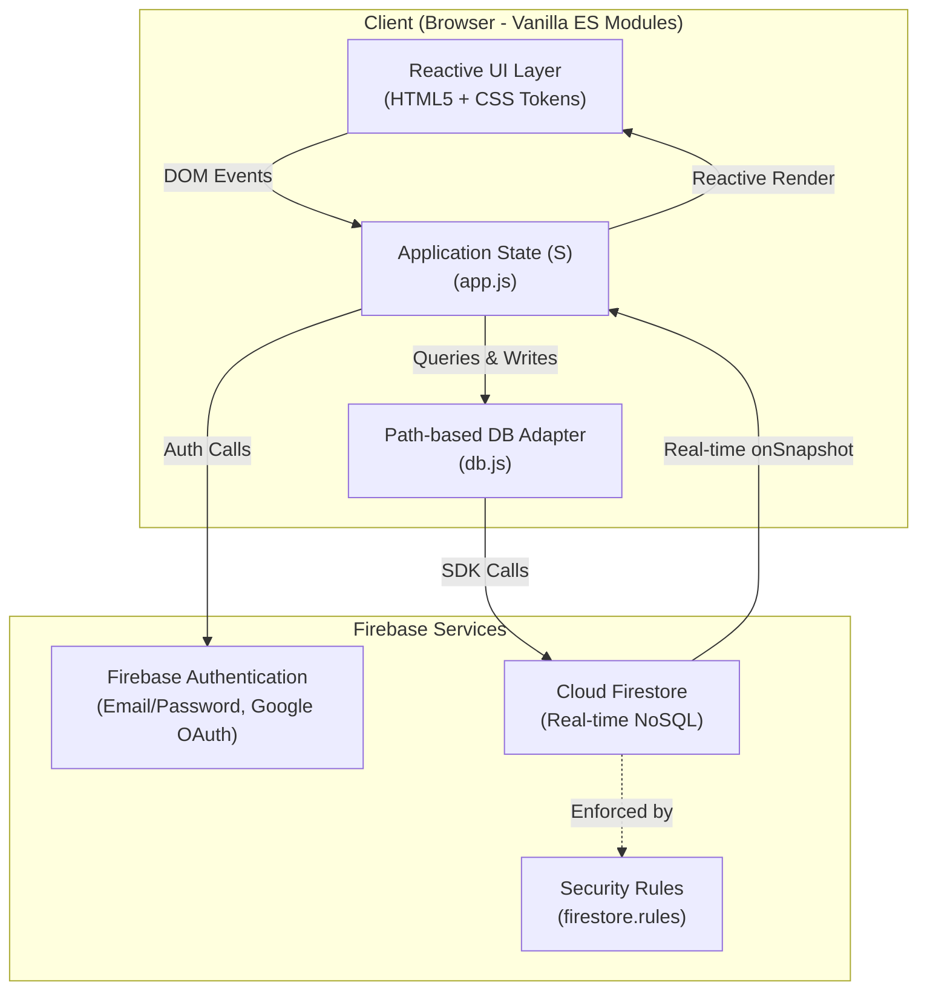
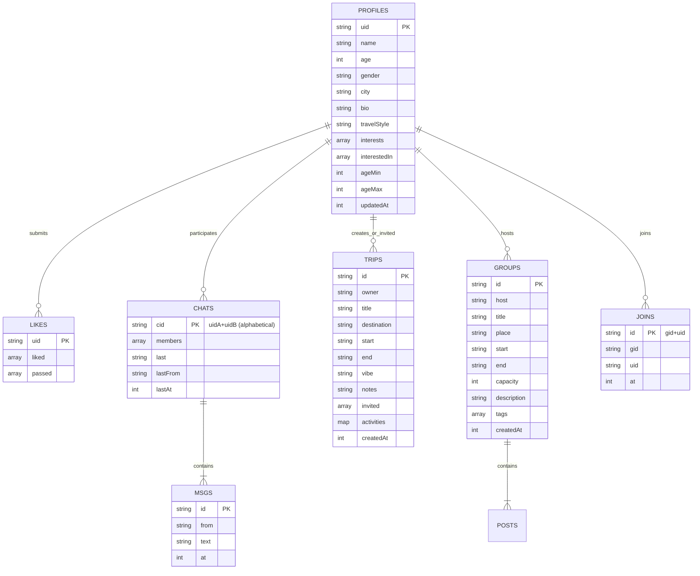

# Architecture & Technical Design 🧭

Roammate is built as a zero-build, ultra-fast client-side application using modern vanilla JavaScript (ES Modules), CSS custom properties, and Firebase (Authentication + Cloud Firestore).

---

## 1. High-Level System Architecture



---

## 2. State Management & Lifecycle

The entire application runs on a reactive, centralized singleton state object `S` defined in [`app.js`](app.js):

```javascript
const S = {
  db: null,           // Database client instance
  auth: null,         // Auth client instance
  user: null,         // Firebase user object
  me: null,           // Current user UID
  canWrite: true,     // Write permission flag
  profiles: {},       // Cache of all dating profiles
  likes: {},          // Likes / passes dictionary
  chats: {},          // 1:1 conversation metadata
  trips: {},          // User's owned & invited trips
  groups: {},         // Available group trips
  joins: {},          // Group trip memberships
  tab: "discover",    // Active navigation tab (discover, matches, trips, groups, profile)
  view: null,         // Active drill-down view (chat, trip, group)
  sub: {},            // Active collection sub-listener (messages, posts)
  seenMatches: null,  // Set of matches seen to toast new matches
  groupFilter: "foryou", // Active group trip filter ("foryou" | "mine")
  editing: false      // Profile edit mode toggle
};
```

### Reactive Render Cycle & Input Preservation
Because Roammate uses standard DOM re-rendering without a heavy virtual-DOM framework, it implements a state-preserving rendering cycle:
1. `keepInputs()`: Before re-rendering, queries any elements with `data-keep`, preserving their current form values, active focus, and cursor selection range.
2. `render()`: Reconstructs the template string corresponding to the current `S.tab` and `S.view`.
3. `restoreInputs()`: Restores input values, active focus, and cursor positions smoothly so real-time Firestore updates never interrupt user typing.

---

## 3. Data Model & Firestore Schema



---

## 4. Matching Algorithm

The matching engine uses a two-phase pipeline:

### Phase 1: Mutual Preference Filtering (`fits(a, b)`)
Both candidate $A$ and candidate $B$ must mutually satisfy each other's criteria:
1. Target gender preference (`interestedIn` includes target gender or is open to all).
2. Age bracket filter (`age >= ageMin` and `age <= ageMax`).

### Phase 2: Compatibility Scoring (`score(a, b)`)
Candidates passing Phase 1 receive a score between 50% and 99%:
- **Base Score:** 50%
- **Shared Interests:** $+10\%$ per shared interest (capped at $+30\%$)
- **Travel Style Match:** $+14\%$ if `travelStyle` is identical
- **Same Home City:** $+5\%$ if case-insensitive city names match

```javascript
// Score calculation logic from app.js
function score(a, b) {
  const shared = (a.interests || []).filter(i => (b.interests || []).includes(i)).length;
  let s = 50 + Math.min(shared * 10, 30);
  if (a.travelStyle && a.travelStyle === b.travelStyle) s += 14;
  if (a.city && b.city && a.city.trim().toLowerCase() === b.city.trim().toLowerCase()) s += 5;
  return { pct: Math.min(s, 99), shared };
}
```

---

## 5. Security & Access Control

Security is enforced at the database level through [`firestore.rules`](firestore.rules):
- **Profiles & Likes:** Any authenticated user can read public profile data; users can only modify their own documents.
- **1:1 Chats:** Readable and writable strictly by the two participants defined in `resource.data.members`. Chat IDs are strictly normalized as `uidA + '+' + uidB` in alphabetical order.
- **Private Trips:** Access is restricted to the trip `owner` and users present in the `invited` array.
- **Group Trips:** Publicly readable by all signed-in users; edits and deletions are restricted to the trip `host`.
- **Joins:** Single document per user-group pair (`gid + '+' + uid`) ensuring duplicate prevention and user-only cancellation.
